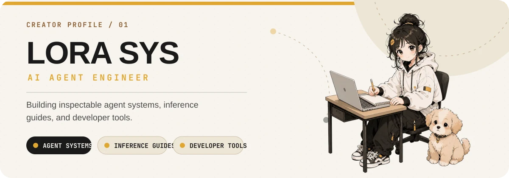

<!-- Lora approved profile v5. Asset provenance: output/v5/sources.json. -->

<h1 align="center">Lora</h1>

学生开发者 · 中国西安 · 写 AI Agent，也写把源码讲明白的交互教程

<a href="https://lora-sys.github.io/loraSys/">网站</a> · <a href="https://lora-sys.github.io/loraSys/projects">项目</a> · <a href="https://lora-sys.github.io/loraSys/blog">文章</a> · <a href="https://lora-sys.github.io/loraSys/rss.xml">RSS</a> · <a href="mailto:lorasys@outlook.com">邮箱</a>

## 做过的

- **[Glassbox](https://github.com/lora-sys/Glassbox-Agent-Harness)** — 权限优先的个人 Agent 工作台，管理身份、记忆、权限与任务执行。项目仍在开发中。
- **[nano-vLLM 交互教程](https://lora-sys.github.io/nano-vllm-interactive-guide/guide/00-start)** — 把推理调度、KV Cache 和采样讲成可以在浏览器里跑的实验。
- **[AgentArena](https://github.com/lora-sys/AgentArena)** — 让三支 Agent 团队处理同一任务，留下提案、证据与对战回放。
- 向 [cloudwego/eino-examples](https://github.com/cloudwego/eino-examples/pull/227)、[portdeveloper/nad-agent](https://github.com/portdeveloper/nad-agent/pull/49)、[nishuzumi/moss](https://github.com/nishuzumi/moss/pull/29) 等项目贡献过代码，链接指向对应的已合并 PR。

## 写过的

写 Agent 架构、记忆与评测，结合源码和实验记录拆解实现。几篇代表文章：[Agent 该继续跑还是重新开一轮](https://lora-sys.github.io/loraSys/blog/agent-budget-memory-evaluation) · [把 Agent 拆成三层](https://lora-sys.github.io/loraSys/blog/tau-agent-architecture) · [Agent 开发的测试与审查](https://lora-sys.github.io/loraSys/blog/ai-engineering-harness)。

## 数据和贡献

<a href="https://github-readme-stats-fast.vercel.app/api?username=lora-sys"><picture><source media="(max-width: 360px) and (prefers-color-scheme: dark)" srcset="https://raw.githubusercontent.com/lora-sys/lora-sys/output/v5/overview-dark-small.svg"><source media="(max-width: 360px)" srcset="https://raw.githubusercontent.com/lora-sys/lora-sys/output/v5/overview-light-small.svg"><source media="(max-width: 680px) and (prefers-color-scheme: dark)" srcset="https://raw.githubusercontent.com/lora-sys/lora-sys/output/v5/overview-dark-mobile.svg"><source media="(max-width: 680px)" srcset="https://raw.githubusercontent.com/lora-sys/lora-sys/output/v5/overview-light-mobile.svg"><source media="(prefers-color-scheme: dark)" srcset="https://raw.githubusercontent.com/lora-sys/lora-sys/output/v5/overview-dark-desktop.svg"></picture></a>
<a href="https://github-readme-stats-fast.vercel.app/api/top-langs/?username=lora-sys"><picture><source media="(max-width: 360px) and (prefers-color-scheme: dark)" srcset="https://raw.githubusercontent.com/lora-sys/lora-sys/output/v5/languages-dark-small.svg"><source media="(max-width: 360px)" srcset="https://raw.githubusercontent.com/lora-sys/lora-sys/output/v5/languages-light-small.svg"><source media="(max-width: 680px) and (prefers-color-scheme: dark)" srcset="https://raw.githubusercontent.com/lora-sys/lora-sys/output/v5/languages-dark-mobile.svg"><source media="(max-width: 680px)" srcset="https://raw.githubusercontent.com/lora-sys/lora-sys/output/v5/languages-light-mobile.svg"><source media="(prefers-color-scheme: dark)" srcset="https://raw.githubusercontent.com/lora-sys/lora-sys/output/v5/languages-dark-desktop.svg"></picture></a>

<a href="https://github.com/Platane/snk"><picture><source media="(prefers-reduced-motion: reduce) and (max-width: 360px) and (prefers-color-scheme: dark)" srcset="https://raw.githubusercontent.com/lora-sys/lora-sys/output/v5/snake-dark-small-static.svg"><source media="(prefers-reduced-motion: reduce) and (max-width: 360px)" srcset="https://raw.githubusercontent.com/lora-sys/lora-sys/output/v5/snake-light-small-static.svg"><source media="(prefers-reduced-motion: reduce) and (max-width: 680px) and (prefers-color-scheme: dark)" srcset="https://raw.githubusercontent.com/lora-sys/lora-sys/output/v5/snake-dark-mobile-static.svg"><source media="(prefers-reduced-motion: reduce) and (max-width: 680px)" srcset="https://raw.githubusercontent.com/lora-sys/lora-sys/output/v5/snake-light-mobile-static.svg"><source media="(prefers-reduced-motion: reduce) and (prefers-color-scheme: dark)" srcset="https://raw.githubusercontent.com/lora-sys/lora-sys/output/v5/snake-dark-desktop-static.svg"><source media="(prefers-reduced-motion: reduce)" srcset="https://raw.githubusercontent.com/lora-sys/lora-sys/output/v5/snake-light-desktop-static.svg"><source media="(max-width: 360px) and (prefers-color-scheme: dark)" srcset="https://raw.githubusercontent.com/lora-sys/lora-sys/output/v5/snake-dark-small.svg"><source media="(max-width: 360px)" srcset="https://raw.githubusercontent.com/lora-sys/lora-sys/output/v5/snake-light-small.svg"><source media="(max-width: 680px) and (prefers-color-scheme: dark)" srcset="https://raw.githubusercontent.com/lora-sys/lora-sys/output/v5/snake-dark-mobile.svg"><source media="(max-width: 680px)" srcset="https://raw.githubusercontent.com/lora-sys/lora-sys/output/v5/snake-light-mobile.svg"><source media="(prefers-color-scheme: dark)" srcset="https://raw.githubusercontent.com/lora-sys/lora-sys/output/v5/snake-dark-desktop.svg"></picture></a>

数据来自 GitHub，由 GitHub Actions 每日生成。

<a href="https://lora-sys.github.io/loraSys/">lora-sys.github.io/loraSys</a> · <a href="mailto:lorasys@outlook.com">lorasys@outlook.com</a> · <a href="#top">回到顶部</a>

